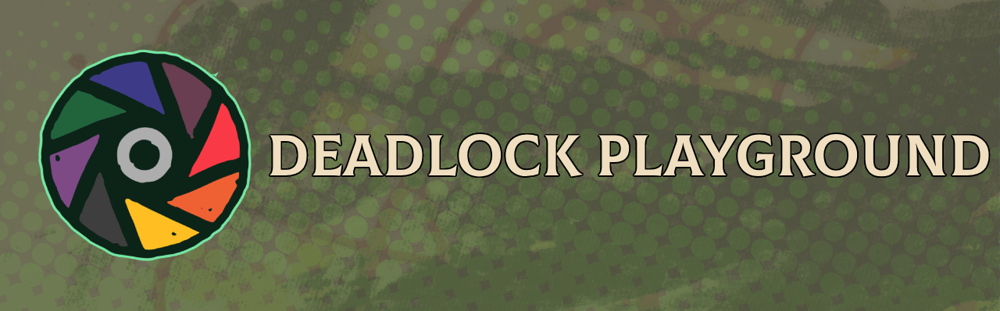
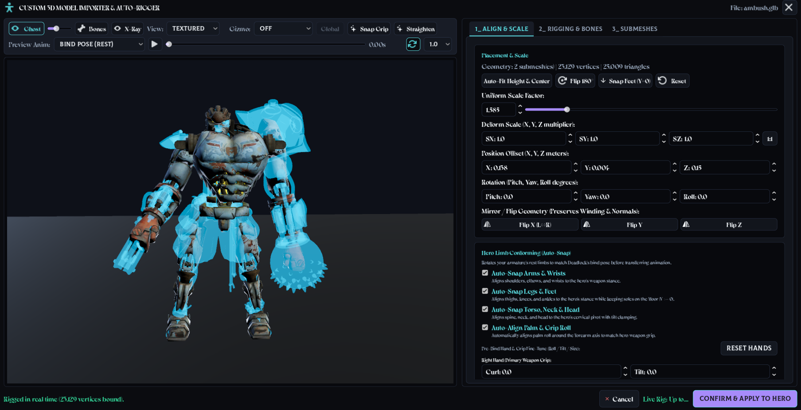
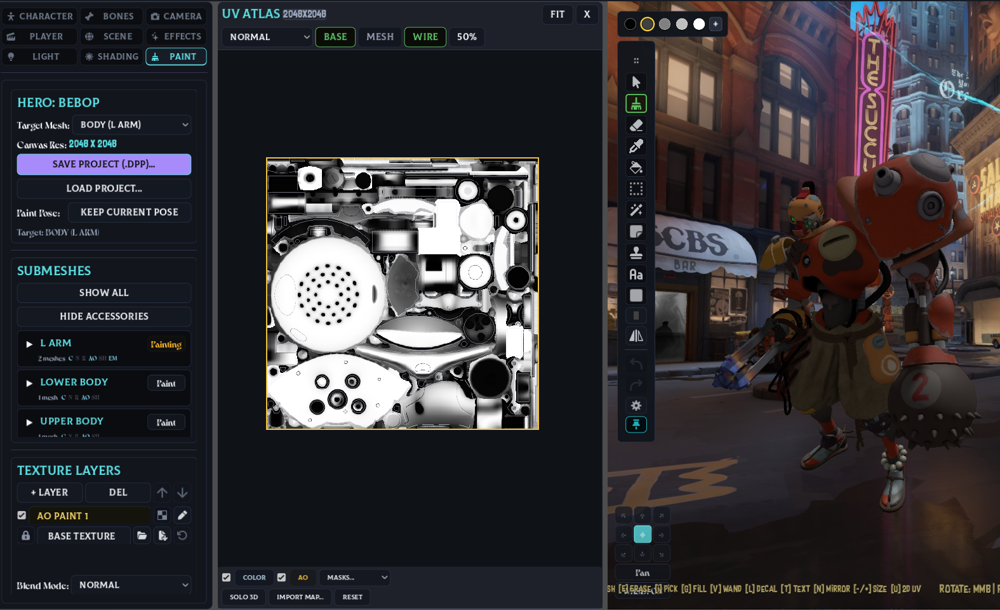
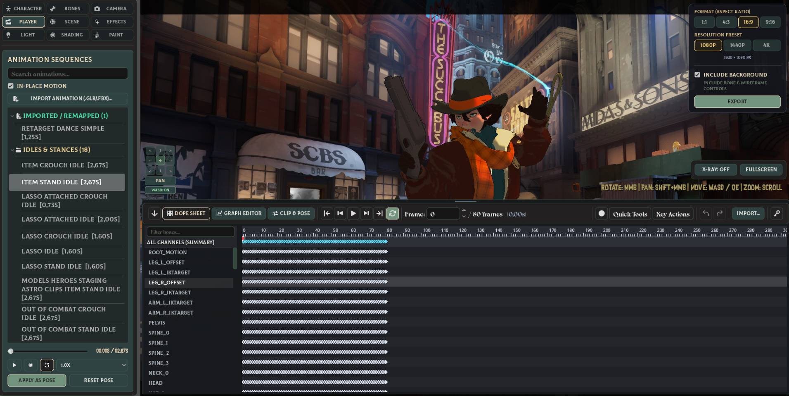
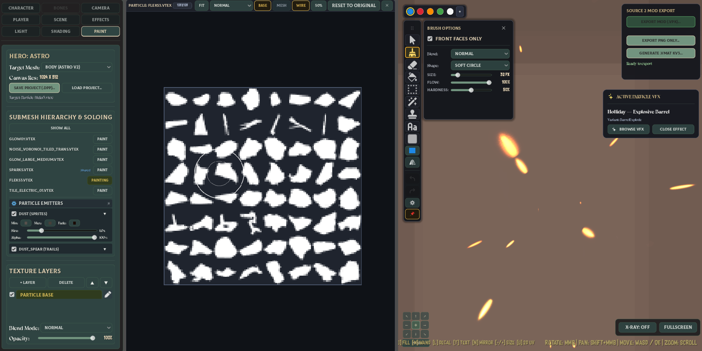

<div align="center">

<!-- IMAGE PLACEHOLDER: Project Banner / Hero Studio Header (replace with docs/images/banner.png or screenshots when ready) -->


  <h1>Deadlock Playground (v1.3.0)</h1>
  <p>
    <strong>An All-in-One Character Modding, 3D Model & Accessory Importer, Texture Painting, Posing, VFX & Animation Tool for Valve's <em>Deadlock</em></strong>
  </p>

  <p>
    <a href="https://github.com/juliancz-a/deadlock-playground/releases/latest">
      
    </a>
    <a href="https://godotengine.org/">
      
    </a>
    <a href="https://dotnet.microsoft.com/">
      
    </a>
    <a href="LICENSE">
      
    </a>
    <a href="#requirements--setup">
      
    </a>
  </p>

  <p>
    <a href="https://github.com/juliancz-a/deadlock-playground/releases"><strong>📦 Download Releases</strong></a>
    •
    <a href="https://deadlock-playground.top/"><strong>🌐 Official Website</strong></a>
    •
    <a href="#-video-demos"><strong>🎬 Video Demos</strong></a>
    •
    <a href="#-key-features"><strong>✨ Features</strong></a>
  </p>
</div>

---

## Overview

**Deadlock Playground** is a free, open-source desktop workspace built in **Godot 4.7.2 (.NET 11 / C#)** that runs 100% locally and offline. Designed for *Deadlock* modders, skin artists, 3D modelers, animators, and content creators, it connects directly to your local Deadlock installation (`pak01_dir.vpk` and installed `.vpk` addons) without requiring manual decompilation into Blender just to paint skins, attach hats/outfits, swap hero models, tweak animations, or compile `.vpk` mods.

> *AI assistance was used while developing the codebase for this project. Features are actively evolving—please report bugs or edge cases via GitHub Issues or on Discord (`juliancz_`).*

---

## Video Demos

### Custom 3D Model & Accessory / Outfit Replacement Demo
[](https://youtu.be/_R9UDjxe85Y)

### Texture Painting & Studio Overview (v1.0 Showcase)
[](https://youtu.be/0GgRUHwB0ek)

---

## ✨ Key Features

### 1. Direct Source 2 & Non-Standard `.vpk` Addon Integration
* **Native VPK Ingestion (`ValveResourceFormat 21.1`):** Directly loads hero models (`.vmdl_c`), materials (`.vmat_c`), textures (`.vtex_c`), animations (`.vnmclip_c`), and particle systems (`.vpcf_c`) from `pak01_dir.vpk` using lock-free deferred VPK streaming.
* **Standard & Non-Standard Mod Support:** Automatically scans `game/citadel/addons/`—including community mods with non-standard internal directory layouts—so you can inspect, combine, or re-export existing skin and animation mods.
* **Portable Multi-Hero Workspaces (`.dpp`):** Save paint layers across multiple materials and channels, imported custom models, fitted accessories, mesh sculpt deltas, keyframes, particle edits, and lighting setups into `.dpp` project files.

### 2. Custom 3D Model Replacer & Accessory / Outfit Importer
* **Full Custom Character Replacement:** Import `.glb`, `.gltf`, or `.fbx` character models into an **Interactive 3D Fitting Room** with a translucent hero ghost reference mannequin, transform gizmos, axis locking, and multi-material inspection.
* **Landmark Auto-Rigging & 3D Weight Paint Editor:** Automatically rig custom characters using Source 2 KNN donor skin-weight transfer + anatomical capsule fallback, manual Landmark Auto-Rig placement, X-Ray wireframe inspection, and an interactive **3D Weight Paint Editor** (Paint / Smooth brushes + T-Pose inverse baking).
* **Accessory & Outfit Part Importer:** Attach up to performance-capped standalone accessories (hats, glasses, capes, backpacks, weapons) rigidly to quick-pick skeleton sockets (`Head`, `Chest / Back`, `Right Hand`, `Left Hand`, `Pelvis`) or replace specific vanilla hero submeshes (e.g., head, torso, weapon) while preserving kept vanilla props.
* **Hero Mesh Deformer & Interactive 3D Sculpt Brush:** Sculpt, flatten, smooth, push, or tuck underlying vanilla hero meshes (such as hair or shoulder pads) so custom hats and armor fit cleanly with zero clipping.
* **Direct Source 2 Compilation:** Sanitized Deadlock NPR/toon PBR shader conversion with automatic AO/Normal/Roughness detection and headless `resourcecompiler.exe` `.vmdl_c` / `.vmat_c` compilation directly into your addon `.vpk`.



### 3. Multi-Channel 3D & 2D UV Texture Painting
* **Dual Synchronized 3D + 2D UV Canvas:** Paint directly on the 3D hero/accessory surface via GPU compute projection (`brush_compute.glsl`) or on the unwrapped 2D UV canvas (`UVCanvas2DUI`).
* **Multi-Channel PBR Workflow:** Switch seamlessly between **Color (Albedo), Normal, Roughness, Ambient Occlusion (AO), Shadow Map, and Self-Illum / Emissive** channels—with smart toolbar decluttering that hides maps absent on the active material.
* **Base Texture Unlock, Eraser & Alpha Protection:**
  * Unlock the **BASE TEXTURE** layer to paint, apply filters/adjustments, or erase pixels directly to transparency.
  * Toggle **Clip Paint Layers to Base Alpha** so strokes and fills automatically respect Source 2 alpha cutouts and packed masks.
  * Inspect alpha transparency live in the 2D UV Canvas using the **Alpha Preview** mode and checkerboard backdrop.
* **Professional Brush, Selection & Filter Suite:** Non-destructive layer stack (Normal, Multiply, Screen, Overlay, HSL Color blend), Clone Stamp Tool, Magic Wand / Lasso / Polygonal / Marquee selection masks, 3D Decal & Typography Projectors, Photoshop-grade **Filters** (Gaussian/Box/Motion Blur, Sharpen, Pixelate, Halftone, Oil Paint, Emboss, High Pass, Noise, Chromatic Aberration), and **Color Adjustments** (Gradient Maps with `.grd` import, Levels, Curves, Hue/Saturation, Exposure, Posterize, Threshold).

<!-- IMAGE PLACEHOLDER: Multi-Channel Texture Painter & 2D UV Canvas Screenshot -->


### 4. Animation Studio Deck, Local/Global Gizmos & Retargeter
* **Blender-Style Bottom Dock (`AnimationStudioDock`):**
  * **Dope Sheet:** Keyframe summary row, marquee selection, `Shift+D` duplication, snapping, and batch retiming.
  * **Graph Editor:** Continuous Euler F-Curves (`Roll, Pitch, Yaw`) and Translation (`X, Y, Z`) with Bezier handle modes (`Auto`, `Aligned`, `Vector`, `Free`) and non-destructive procedural Modifiers (`Noise`, `Cycles`, `Stepped`, `Limits`).
* **3D Viewport Posing, Local/Global Transforms & Constraints:**
  * Manipulate bones with interactive 3D gizmos supporting **Local Bone Axes vs. Global World Axes** (`Local` / `Global` button or hotkey **`L`**), bilateral pose mirroring, and real-time **Auto-Keying**.
  * Evaluate Source 2 **Bone Constraints** (all 11 ModelDoc constraints via `Source2BoneConstraintDriver`), `FeModel` jiggle bone spring physics, analytical Two-Bone IK, and Position-Based Dynamics (PBD) cloth conformance.
* **External Retargeting & VPK Export:** Import Mixamo, Mesh2Motion, or custom `.glb`/`.gltf`/`.fbx` humanoid clips, retarget with T-Pose/A-Pose calibration, edit loaded addon animation mods (`Modified` category), and export native `.vnmclip_c` binaries with automated Source 2 IK constraints straight to `.vpk`.



### 5. Hero Particle VFX Studio, Themes & Virtual Photography
* **Particle VFX Simulation & Texture Repainting:** Preview hero `.vpcf_c` systems via VRF 21.1 SoA `ParticleSystemSimulation` with physics collision and model socket attachments, scrub timelines, and repaint particle sprite sheets cleanly back into `.vpk`.
* **1-Click `.vpk` Mod Builder:** Automatic addon index resolution (`pak##_dir.vpk`), staged in-place `.vtex_c` / `.vmdl_c` / `.vnmclip_c` compilation, and mod change overview modal.
* **Custom UI Theme System & Staging Studio:** Built-in theme switcher with custom theme editor and JSON export/import, plus 3D environment/camera lighting presets, Depth of Field, Color Grading, and high-res transparent PNG captures for Discord & GameBanana showcases.



---

## Requirements & Setup

### For Mod Creators (Pre-built Releases)
1. Download the latest Windows x64 archive from [**Releases**](https://github.com/juliancz-a/deadlock-playground/releases).
2. Extract and launch `DeadlockPlayground.exe`.
3. Select your local Deadlock installation folder (for `pak01_dir.vpk` and addons). *(Optional: point to Deadlock Modding Tools / `resourcecompiler.exe` for exporting custom 3D models & textures directly to `.vpk`.)*

### For Developers (Building from Source)
1. **Godot Engine 4.7.2 (.NET / C#):** Download the standard .NET build of Godot 4.7.2 from [godotengine.org](https://godotengine.org/download/).
2. **.NET 11.0 SDK:** Install the [.NET 11 SDK](https://dotnet.microsoft.com/download/dotnet/11.0).
3. **NuGet Dependencies:** Uses [`ValveResourceFormat` (`21.1.7798`)](https://github.com/ValveResourceFormat/ValveResourceFormat), `ValvePak`, `ValveKeyValue`, `SharpGLTF.Core`, and `SharpCompress` (configured in `src/Deadlock_Playground.csproj`).

```bash
git clone https://github.com/juliancz-a/deadlock-playground.git
cd deadlock-playground
dotnet restore src/Deadlock_Playground.csproj
dotnet build src/Deadlock_Playground.csproj
```
Open `src/project.godot` in **Godot 4.7.2 (.NET)** and run the project, or press `F5`!

---

## Acknowledgments & Open-Source Credits

* **Engine:** Powered by [Godot Engine 4](https://godotengine.org/) (.NET / C#).
* **Source 2 Pipeline:** Powered by [ValveResourceFormat (Source 2 Viewer)](https://github.com/ValveResourceFormat/ValveResourceFormat), `ValvePak`, and `ValveKeyValue` by the Steam Database community.
* **SVG Icons:** [at-icons](https://github.com/Voxybunsl/at-icons) (MIT License) by Voxybuns.
* **GPU Texture Painter Plugin:** [gpu-texture-painter](https://github.com/maantho/gpu-texture-painter) (MIT License) by maantho.
* **Gizmo3D Plugin:** [Gizmo3D](https://github.com/chrisizeful/Gizmo3D) (MIT License) by chrisizeful.
* **Vector Textures:** [Pop Art Texture Vectors](https://www.vecteezy.com/free-vector/pop-art-texture) by Vecteezy.

> **Disclaimer:** *This is a community-made third-party modding & asset utility and is not affiliated with or endorsed by Valve Corporation. Deadlock and all related Source 2 assets belong to Valve Corporation.*

---

## License

This project is licensed under the **MIT License**. See the [LICENSE](LICENSE) file for complete details.
